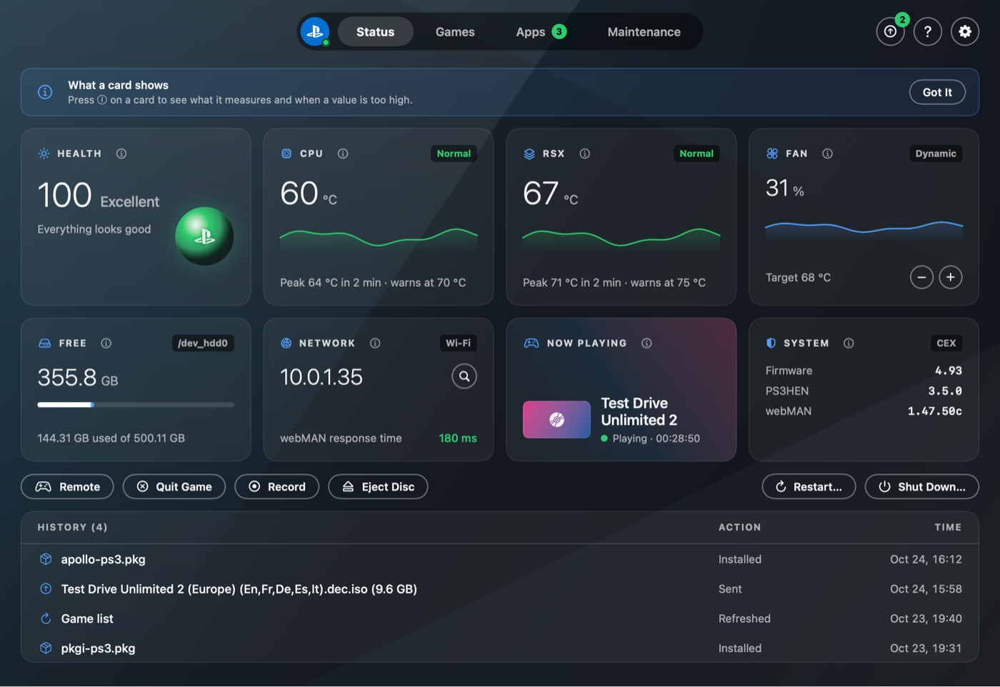
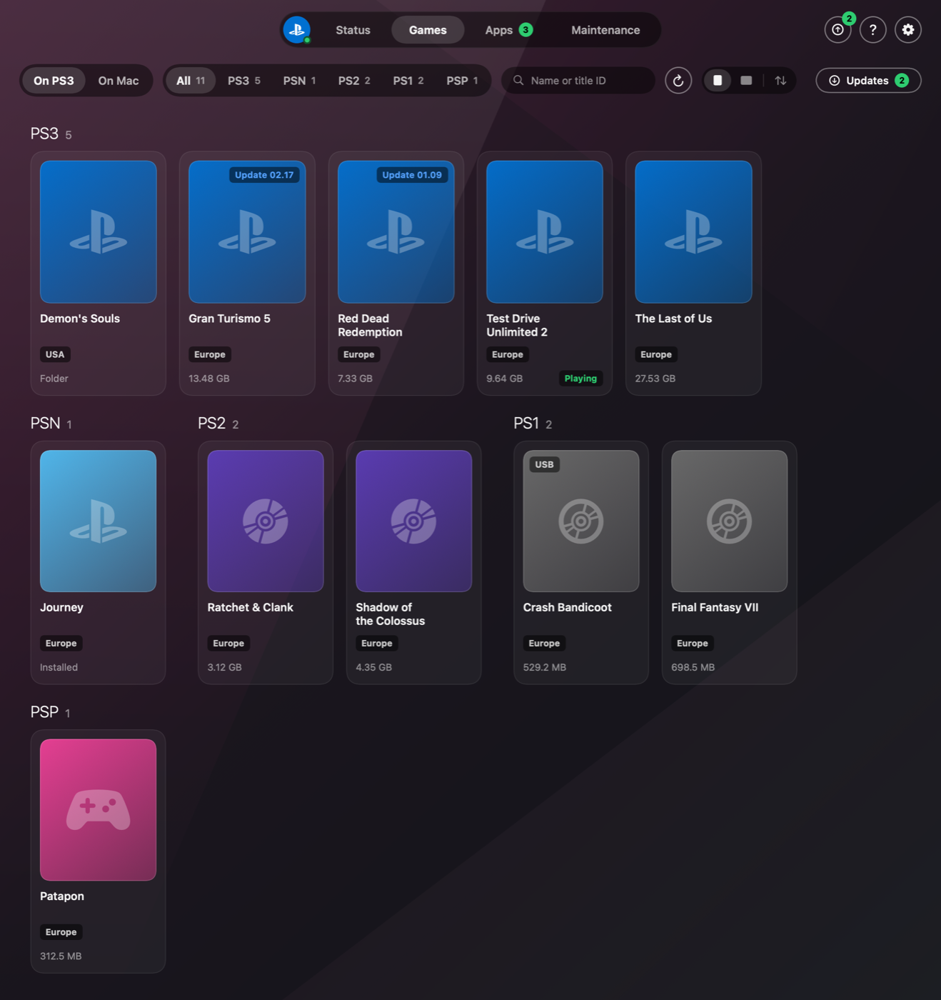
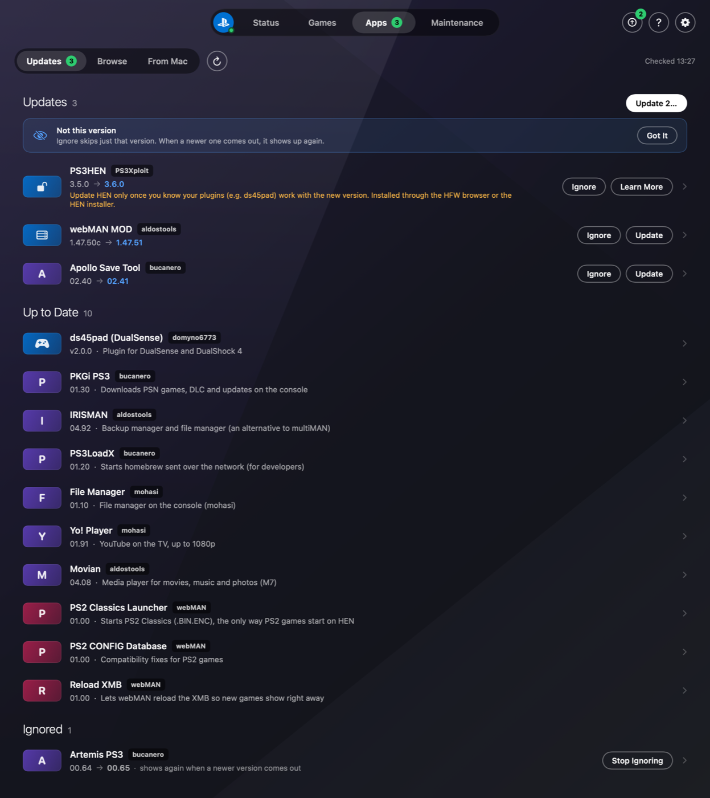

# PS3 Center

Control your PS3 from your Mac. Upload games, install and update homebrew, back up saves and keep
an eye on temperatures, all over the network: no menus on the console and no USB stick. PS3 Center
is a Mac app and a `ps3` command for Terminal that share the same engine.



## Download

**[⬇ Download PS3 Center for Mac](https://github.com/melker-asp/ps3center/releases/latest/download/PS3-Center.dmg)**
· macOS 14 Sonoma or newer · Apple silicon and Intel · [all versions](https://github.com/melker-asp/ps3center/releases)

1. Open **PS3-Center.dmg** and drag **PS3 Center** to **Applications**.
2. Open PS3 Center. The first time, macOS stops it because the app isn't notarized by Apple
   (that needs a paid developer account). Click **Done**, open **System Settings → Privacy &
   Security**, scroll down to *"PS3 Center" was blocked* and click **Open Anyway**, then confirm.
   On macOS 14 you can instead Control-click the app in Applications, choose **Open** and confirm.
3. When macOS asks, **allow** PS3 Center to find devices on your local network. That is how it
   reaches the PS3. If you said no, turn it on in System Settings → Privacy & Security → Local
   Network.

The setup guide then finds the PS3 on your network. To update, download the new version and
replace the app in Applications; your settings stay.

### What the PS3 needs

- **PS3HEN** (or a CFW), enabled. On HEN that means enabling it again after every restart of the
  console.
- **[webMAN MOD](https://github.com/aldostools/webMAN-MOD/releases)** installed. PS3 Center talks
  to its web server and FTP.
- The PS3 and the Mac on the **same network**. A cable is much faster than Wi-Fi for big games, and
  the app shows how to connect one straight to the Mac.

No games are included or downloaded: PS3 Center sends your own files.

### The `ps3` command (optional)

Everything the app does, `ps3` can do in Terminal too. This puts it in `~/.local/bin`:

```bash
mkdir -p ~/.local/bin
curl -fsSL https://github.com/melker-asp/ps3center/releases/latest/download/ps3-cli.zip -o /tmp/ps3-cli.zip
unzip -o /tmp/ps3-cli.zip -d ~/.local/bin
```

Run the same lines again to update. If Terminal says `command not found: ps3`, add the folder to
your PATH and open a new window:

```bash
echo 'export PATH="$HOME/.local/bin:$PATH"' >> ~/.zshrc
```

If you download **ps3-cli.zip** in the browser instead, macOS quarantines the file; run
`xattr -d com.apple.quarantine ~/.local/bin/ps3` once.

## The Mac app

<p>
  
  
</p>

The app has four tabs in Mole style:
- **Status:** health, CPU, RSX, fan, free space, network, what is playing and versions, with
  live curves and the history from `ps3 history`. Below the cards: Remote (d-pad and
  buttons, arrow keys and Return/Esc; watch on the TV; it also has Reload XMB, Beep,
  In-Game Screenshots and In-Game Music), Quit Game and Record while a game is running, Eject
  Disc, Restart and Shut Down. In dynamic fan mode − and + move webMAN's target temperature
  (60–75 °C).
- **Games:** the games on the PS3 as a grid with cases or XMB icons, filters per platform, search and
  sorting by name, size or recently added.
  Click a game for title ID, region, size and version, and to start, mount, delete,
  uninstall (installed games; the saves stay) or update it. "Check for Updates" asks Sony for new patches. Drag an image onto the game's
  banner to change the cover. PS1 and PS2 games say if something is in their way: a PS2 ISO doesn't start
  on HEN (only PS2 Classics do), and a PAL PS1 game with LibCrypt gets its data with a
  button press. A game folder in GAMES can be checked against the original disc's IRD. Under **Mac** the games in your connected Game Folders are shown, with what
  is already on the PS3; select games and press Send. Files dragged onto the window go the same way.
  **Game Server** (under Mac) lets the PS3 play the ISOs straight from the Mac without copying them.
  "Set Up webMAN for Me" fills in a free network server in webMAN and leaves the rest of the
  settings as they were (a copy of them is saved first).
- **Transfers** (the arrows at the top right): the queue with progress, Start/Pause, "When the Queue Finishes"
  (notify or shut down the PS3), MD5 verification and speed measurement. The Mac is kept awake while the queue runs,
  and the queue pauses cleanly when the Mac goes to sleep and continues when it wakes. If the connection breaks
  the queue retries (after 15 s, 30 s, 1, 2 and 4 minutes) and continues where the file left off. In Game Folders
  a folder can be **watched**: new games in it are put in the queue and sent when they have finished copying.
  If the PS3 is on Wi-Fi the review shows how long it would take with a cable, and if the Mac is on
  battery it says that the queue stops if the lid is closed. Games sent from the Mac keep their
  title, title ID and icon on the PS3 right away, before webMAN has read them.
- **Apps:** updates ("02.40 → 02.41", Update / Ignore / Update All) and a
  Browse list. Ignore skips just that version; if a newer one comes, it is shown again. Update
  All first shows a review (what is installed, size, what is skipped and why) and
  afterwards a report: Done, Failed and Skipped. An installed app can be
  uninstalled from its page. Under From Mac the .pkg files in your package folders are shown (the
  Package Folders button), with whether they are already installed; they are installed with one click and stay on
  the Mac.
  The icons are the apps' own XMB icons from the console. Click an app for a
  detail page with version, whether it works on your PS3 and the README with images from GitHub.
- **Maintenance:** the saves are copied to the Mac (automatically once a week, or with Back Up Now) and
  can be put back, and a save can be deleted from the PS3 (a copy is saved first); the system files are copied on request; Cleanup finds forgotten packages,
  interrupted transfers, duplicates, a large cache and missing plugins and removes what it can;
  Storage shows what takes up space; Disc copies the PS3 disc in the drive to the hard drive; Videos
  & Photos imports recordings and screenshots to `~/Pictures/PS3 Center`. Cleanup also says
  whether system updates are blocked, with a button that blocks them.

The **menu bar** shows temperatures, what is playing, the queue and the game server, with Send Files…,
Refresh Game List, Quit Game and Shut Down; the app keeps running there when the window is closed
(Launch at Login is in the same menu). In Finder there is **Send to PS3** under Services and
Quick Actions, and in Shortcuts there are PS3 Status, Start Game on PS3, Shut Down PS3 and Send
to PS3. If the PS3 is on but HEN isn't enabled, the connection screen says so. The game page shows how
long you have played a game and when you last played it. Notifications arrive when the queue finishes, when
the console gets hot and when an app has a new version.

The look follows the PlayStation app: blue splash screen, dark base with a color per tab, white buttons and
the games' own images. The gear at the top right (or ⌘,) opens Settings: the tab the app opens in,
Launch at Login and the menu bar icon, the PS app's themes, the PS3 folder (Create… makes an empty one
if you don't have one), Game and Package Folders, how the queue ends, MD5 checks, the weekly save
backup, the FTP tuning, which notifications you get, which status cards and tabs show, °C or °F and
the text size. It works before a console is connected. The first launch opens a setup guide, the ?
next to the gear (or ⌘?) opens Help with a guide for each task, and ⓘ on a card explains it.
From Terminal, `ps3 config set root ~/Documents --create` makes the same empty PS3 folder.

## Commands

| Command | Does |
|---|---|
| `ps3` | A menu with the most common commands when run in a terminal; type a number or a command. In a script the help is shown |
| `ps3 status` | Health, temperatures, fan, free space and what is running. `--watch` updates continuously, `--json` gives JSON |
| `ps3 games` | The games on the PS3 per platform: title ID, region, size, version and installed updates (`--platform ps2`, `--sort size\|added`, `--json`) |
| `ps3 games info <name>` | Everything about a game. The name can be part of the title, a title ID or the path |
| `ps3 games play <name>` | Starts the game. If another game is running it first asks whether to quit it (`-y`, `--dry-run`) |
| `ps3 games mount\|unmount\|exit` | Mounts a game as a disc, unmounts it or quits the game that is running |
| `ps3 games delete <name>` | Deletes the game's files from the PS3 after a question, or uninstalls an installed game (`--dry-run`, `-y`) |
| `ps3 games covers` | Downloads covers to the Mac; `--to-ps3` puts the PS3 covers where webMAN looks |
| `ps3 games updates` | Official updates (patches) from Sony for the games |
| `ps3 games update <name>` | Downloads, verifies and installs a game's patches (`--all`, `--dry-run`, `-y`). Never system software |
| `ps3 games mac` | The games in the Mac's game folders and whether they are already on the PS3 (`--missing`) |
| `ps3 games libcrypt <name>` | Puts the LibCrypt data that a PAL PS1 game needs in `/dev_hdd0/tmp/lsd` (from webMAN MOD, `--dry-run`) |
| `ps3 config folder add PS3ISO ~/Games/PS3` | Connects a game folder on the Mac per type (PS3ISO, GAMES, PS2ISO, PSXISO, PSPISO, BDISO, DVDISO) |
| `ps3 config folder add PKG ~/Packages` | Connects a package folder with .pkg files (see `ps3 apps mac`) |
| `ps3 config folder watch ~/Games/PS3` | Watches a connected folder; `ps3 watch` (or the app) puts new games in the queue (`--send` sends right away) |
| `ps3 queue add <files or games>` | Puts games in the queue that the app also uses; `ps3 queue start` sends one at a time (`--when-done shutdown`, `--verify`) |
| `ps3 serve` | The game server: the PS3 plays ISOs straight from the Mac's game folders via webMAN's `/net0` (port 38008, read-only, only the PS3 is let in) |
| `ps3 speedtest` | Measures how fast it goes to and from the PS3; gives time estimates in the queue |
| `ps3 usb prepare /Volumes/X <games>` | Copies games to a FAT32 drive in webMAN's folders. ISOs over 4 GB are split, and a game folder with a file over 4 GB becomes an ISO |
| `ps3 iso make <folder> [target]` | Makes a PS3 ISO of a game folder, like PS3 ISO Tools and makeps3iso (split on a FAT32 drive) |
| `ps3 iso split\|join\|extract <file>` | Splits an ISO for FAT32, joins `.iso.0` …, extracts an ISO to a game folder |
| `ps3 ps2 keys --fetch` | Downloads the keys for PS2 Classics from webMAN MOD's repo to the Mac (`--import` takes your own files) |
| `ps3 ps2 classic <iso, cue>` | Turns a PS2 game into a PS2 Classic (`.BIN.ENC`), the only way PS2 games start on HEN |
| `ps3 power off\|restart` | Shuts down or restarts the PS3 (on HEN, HEN must be enabled again after a restart) |
| `ps3 disc eject\|insert` | Ejects or inserts the disc |
| `ps3 fan [70]` | The fan's speed and mode; with a number the target is moved in webMAN's dynamic mode (60–75 °C) |
| `ps3 pad down down ok` | Presses buttons with webMAN's virtual controller (`ps3 pad off` disconnects it) |
| `ps3 screenshot [file]` | Saves an image of the XMB on the Mac |
| `ps3 record` | Starts or stops recording of the game that is running (720p MP4 in `/dev_hdd0/VIDEO`) |
| `ps3 media [pull\|screenshots]` | New videos and screenshots on the PS3; `pull` copies them to `~/Pictures/PS3 Center`, `screenshots` allows screenshots in all games |
| `ps3 beep [1–3]` | The PS3 beeps, so you can find it |
| `ps3 music on\|off` | Lets music from the XMB play during games, or not (until the next restart, `--dry-run`) |
| `ps3 send <files/folders>` | Uploads to the right folder via `.part` files, continues interrupted uploads, skips games that already exist, refreshes the game list and shows a popup. Keeps the Mac awake; `--verify` compares MD5, `--shutdown-when-done` shuts down the PS3 afterwards |
| `ps3 saves [backup\|local\|restore <name>]` | The saves on the PS3, copy them to the Mac, put one back (not during a game; what was there is saved first) |
| `ps3 saves delete <name>` | Deletes a save from the PS3 after it has been copied to the Mac (`--dry-run`, `-y`) |
| `ps3 backup` | Saves and system files (xRegistry.sys, webMAN's settings, boot_plugins) to the Mac; only reads the console |
| `ps3 maintain [--fix]` | Forgotten packages, interrupted transfers, duplicates, cache, missing plugins and whether system updates are blocked; `--fix` removes packages and `.part` files |
| `ps3 maintain block-updates` | Puts webMAN MOD's `ps3-updatelist.txt` on the PS3, so that no system update is downloaded by accident (`--off`, `--dry-run`) |
| `ps3 verify <iso, folder or game>` | Checks a disc copy file by file against the original's IRD (from FlexBy420's database, or `--ird file`) |
| `ps3 analyze` | What takes up space on `/dev_hdd0`, counted on the console |
| `ps3 rip` | Copies the PS3 disc in the drive to `/dev_hdd0/GAMES` (`--abort` stops) |
| `ps3 apps` | Installed apps compared with the latest version on GitHub |
| `ps3 apps available` | The whole catalog: what you have (✓), what has updates (↑), what can be installed (↓) and what doesn't work on your PS3 (⊘) |
| `ps3 apps info <name>` | Version, whether the app works on your PS3 and the README from GitHub (`--no-readme`, `--json`) |
| `ps3 apps install <name…>` | Downloads the latest version from GitHub and installs, e.g. `ps3 apps install ezremote` (`--reinstall`, `--dry-run`) |
| `ps3 apps install <pkg…>` | Installs a custom .pkg file directly and archives it in `_Installed/Packages`; a package in the package folders (filename or title ID is enough) stays where it is |
| `ps3 apps mac` | The packages in the Mac's package folders and whether they are installed (`--missing`, `--offline`, `--json`) |
| `ps3 apps uninstall <name>` | Uninstalls an app (the folder in /dev_hdd0/game); not HEN, webMAN or plugins (`--dry-run`, `-y`) |
| `ps3 apps update [name…]` | Review and install updates; ignored ones are skipped unless given by name (`--dry-run`, `-y`) |
| `ps3 apps ignore [name…]` | Skips the latest version of an app; without a name it shows what is ignored. A newer version is shown again |
| `ps3 apps unignore <name…>` | Shows an app's updates again |
| `ps3 popup <text>` | Shows a message on the TV |
| `ps3 refresh [--xmb]` | Refreshes the game list (like SELECT + L3); `--xmb` reloads the XMB too |
| `ps3 error <code>` | Explains an error code like 80010006, and the most common ones for disc, Blu-ray, video, network and account |
| `ps3 mcp` | MCP server so that e.g. Claude can read and troubleshoot the PS3 (see Claude and MCP) |
| `ps3 history` | What the tool has changed (`~/Library/Logs/ps3center/operations.log`) |
| `ps3 guide [name]` | The how-to guides and the glossary, the same as Help in the app |
| `ps3 discover` | Finds the PS3 on the network and saves the address |
| `ps3 config [set host/root …]` | Settings in `~/.config/ps3center/config.json` |

- **HEN must be enabled,** otherwise webMAN doesn't respond.
- **If the PS3's IP address changes** the tool finds it automatically and saves the new one.
- **While a game is running** uploads start right away, but installation and refreshing the
  game list wait until you have quit the game (`--force` runs anyway).
- **HEN and ds45pad are never updated automatically.** They are only shown with advice.
- **Compatibility check:** before anything is installed the tool reads the console's firmware (HEN or CFW,
  CEX or DEX, version). Apps that don't work on it are blocked, both by name and as a custom
  .pkg file with a known title ID. If the firmware can't be read, apps that have requirements are blocked.

- **Packages from GitHub are verified** against the size and the SHA-256 sum that GitHub gives, before they are
  archived or sent. If they don't match, the file is deleted.
- **New in Browse:** apps whose latest release is at most 30 days old have a row of their own at the top
  and the label New (`ps3 apps available` prints "new version").

## Claude and MCP

`ps3 mcp` is an MCP server over stdio. With it Claude can read the PS3 and help troubleshoot:
status and health, homebrew and updates, the games, the maintenance report, the history and
error codes. The tools only read; changes are made with `ps3` or in the app.

```bash
claude mcp add ps3 -- ~/.local/bin/ps3 mcp          # Claude Code
```

In Claude Desktop it is added to `claude_desktop_config.json`:

```json
{ "mcpServers": { "ps3": { "command": "/Users/<you>/.local/bin/ps3", "args": ["mcp"] } } }
```

Then ask, for example, "Why is my PS3 so hot?" or "What does 8001003D mean?".

## Troubleshooting

`PS3_DEBUG=1 ps3 …` prints the FTP traffic. `PS3_HOST=<ip>` forces a particular address.
`GITHUB_TOKEN` raises GitHub's rate limit.

## Building from source

Requires Xcode (Swift 6). Architecture and the plans are in [DESIGN.md](DESIGN.md) and
[PLAN.md](PLAN.md).

```bash
make install            # the ps3 command: builds and links ~/.local/bin/ps3
brew install xcodegen   # once, for the app
make install-app        # builds a Release version of the app and puts it in /Applications
```

Run them again to update (a running app is quit first). `make test` runs the tests, and
`make run-app` builds a Debug version and opens it straight from `.build`, without installing.
`make snapshot DIR=/tmp/shots` renders the tabs to PNG without opening any window, and
`make snapshot-fixtures DIR=/tmp/shots` does the same without a PS3.

**Releases:** set the version in `App/project.yml` (`MARKETING_VERSION`) and
`Sources/ps3/PS3.swift` (`version:`), commit, then push a tag such as `v1.0.0`. GitHub Actions
(`.github/workflows/release.yml`) tests, builds `PS3-Center.dmg` and `ps3-cli.zip` for Apple
silicon and Intel and publishes the release. `make dist VERSION=1.0.0` builds the same files in
`.build/dist` on your Mac.

## Adding an app to the catalog

Add a `CatalogEntry` in `Sources/PS3Kit/Catalog.swift` with:
- the app's title ID: characters 8–16 of the package's content ID at offset 0x30, the same as the folder name
  under `/dev_hdd0/game/`
- the GitHub repo
- a regular expression for the release file
- how the tags are written (`VersionStyle`)

Packages that ship with someone else's release get `tracksUpdates: false`.

If the app only works on certain consoles it gets `requirements`, e.g. `.cfwOnly`,
`.dexOnly`, `Requirements(minFirmware: "4.80")` or `Requirements(untestedOn: [.cfw])` (warns
but doesn't block). Enter what the README or the release notes say, not guesses.

When PS3 Center installs an app, the link between tag and `APP_VER` is saved in
`~/.config/ps3center/installed.json`. After that the tags are compared directly, so `VersionStyle`
is only needed for apps that were installed some other way.

## License

PS3 Center is free software under the [GNU General Public License v3.0](LICENSE). It is not
affiliated with or endorsed by Sony Interactive Entertainment; PlayStation and PS3 are their
trademarks.
